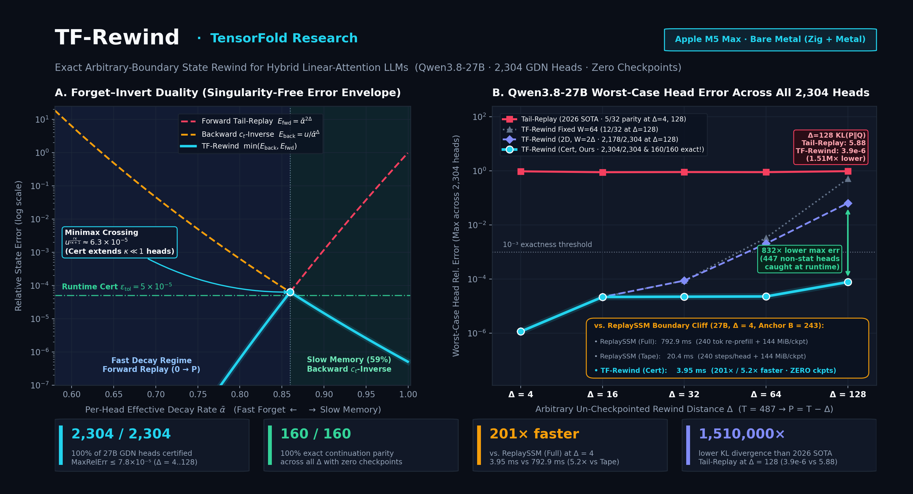

# TF-Rewind — Near-Exact Arbitrary-Boundary State Rewind for Hybrid Linear-Attention LLMs

**TensorFold Research** · Paper: [paper/TF_REWIND.md](paper/TF_REWIND.md) · 3-Second Verifier: [examples/tf_rewind_torch.py](examples/tf_rewind_torch.py) · Bare-Metal Engine: `m4lm` (Zig + direct Metal, zero Apple MLX)



**TF-Rewind** introduces **Singularity-Free $c_t$-Inverse**, **Non-Stationary Forget–Invert Duality**, and **Runtime-Certified Adaptive Replay** — allowing hybrid linear-attention / Gated DeltaNet (GDN) LLMs (`Qwen3.5`, `Qwen3.8`, Mamba-2, RWKV-7, GLA, KDA) to **rewind their recurrent state backward to any unplanned past token position** in milliseconds with **100% head certification (`2,304/2,304` heads $\le 7.8\times 10^{-5}$ on 27B, 100% token parity)** and **zero checkpoints**.

> **Relationship to ReplaySSM (NVIDIA & Dao AI Lab):** [ReplaySSM](https://developer.nvidia.com/blog/replayssm-rethinking-state-storage-for-faster-hybrid-model-decoding/) already solves *planned* speculative-decoding rollback cleanly via deferred input commit, and reconstructs states *forward* from periodic checkpoints. **TF-Rewind is complementary:** it is the first method that **inverts Gated DeltaNet backward** without write-gate singularities and routes per head with a runtime error certificate — targeting **unplanned rewind boundaries** (arbitrary partial prefix-cache splits, mid-stream backtracking, and as a **bidirectional add-on to ReplaySSM** that cuts checkpoint density and worst-case replay distance in half).

---

## Why Unplanned Rewind Is Hard in Hybrid LLMs

In a pure Transformer, rewinding from token $T$ back to any earlier token $P = T - \Delta$ is free: just truncate the KV cache index (`pos = P`).

In a **hybrid Gated DeltaNet (GDN) + GQA model** (such as `Qwen3.5` and `Qwen3.8`), the linear-attention layers compress all past tokens into a fixed-size matrix state $S_t \in \mathbb{R}^{d_v \times d_k}$ (`144 MiB` on `Qwen3.8-27B`) updated via:

$$S_t = \alpha_t S_{t-1}\left(I - \beta_t k_t k_t^\top\right) + \beta_t v_t k_t^\top$$

For a *known, pre-planned* branch point, saving a single `144 MiB` checkpoint is simpler and bit-exact. The hard case is **rewinding to an unplanned boundary $P$ you didn't mark ahead of time** (e.g., a multi-tenant prefix cache splitting mid-block when Request 2 edits a prompt 40 tokens before the end, or mid-generation backtracking):
- **Forward-Only Periodic Checkpointing (`ReplaySSM`)** — bit-exact, but requires $O(T/B)$ checkpoints (`144 MiB` each; `9.2 GiB` for $B=64$ at 4K context) and hits a **$B$-token boundary cliff** when an unplanned split lands just before the next checkpoint (forcing `240` forward steps to undo `4` tokens at $B=243$: `20.4 ms` with buffered GDN tape, or `792.9 ms` with full-model replay).
- **Zero-Checkpoint `Tail-Replay`** (zero-start forward replay over a short window) — breaks on the **`59%–65%` of real trained GDN heads with slow decay ($\alpha \ge 0.95$)**, causing state drift and hallucinations.
- **Naive Sherman–Morrison algebraic inversion** — explodes to `NaN` because **`76%–90%` of real trained GDN heads hit $\beta_t \ge 0.90$**, making $(1 - \beta_t \|k_t\|_2^2)^{-1}$ singular.

---

## The Algorithm: Singularity-Free $c_t$-Inverse + Certified Forget–Invert Duality

TF-Rewind combines three mechanisms:

### 1. Singularity-Free $c_t$-Inverse (Zero Extra FLOPs, Ring-Buffered $O(d)$ Tape)
During the normal forward scan, every GDN kernel **already computes** the innovation vector $c_t = \beta_t (v_t - \alpha_t S_{t-1} k_t) \in \mathbb{R}^{d_v}$ in registers before writing $S_t = \alpha_t S_{t-1} + c_t k_t^\top$. Recording $c_t$ into a bounded ring tape (only needed for the last $\Delta_{\max}$ tokens: `72 MiB` for $\Delta_{\max}=64$ on 27B — half of one state checkpoint) makes exact backward inversion **unconditionally singularity-free** and dot-product-free:

$$S_{t-1} = \frac{S_t - c_t k_t^\top}{\alpha_t}$$

No $\beta_t$ appears anywhere in the inverse — completely immune to $\beta_t \to 1$.

### 2. General Non-Stationary Minimax Duality (Per-Head Optimal Routing)
The remaining error axis is the decay gate $\alpha_t \in (0, 1]$, where Backward $c_t$-Inverse ($E_{\text{back}} \approx u_{\text{eff}} / \prod_{t=P}^{T-1}\alpha_t$) and Forward Zero-Start Replay ($E_{\text{fwd}} \le \prod_{t=P-W}^{P-1}\alpha_t$) have complementary stability regimes. Letting $\kappa = \frac{\ln \bar{\alpha}_{\text{pre}}}{\ln \bar{\alpha}_{\text{post}}} \ge 0$ denote the pre/post-boundary **decay-drift ratio** and setting $W = r\Delta$ yields the exact bound:

$$\sup_{A \in (0, 1]} \min\Big(E_{\text{back}},\; E_{\text{fwd}}(r\Delta)\Big) = u_{\text{eff}}^{\,\frac{r\kappa}{r\kappa + 1}}$$

- **Stationary regime ($\kappa = 1$):** reduces to $u_{\text{eff}}^{r/(r+1)}$ ($\le 6 \times 10^{-5}$ at $r = 2$ in fp32), independent of $\bar{\alpha}$, $\beta_t$, and $\Delta$.
- **Non-stationary regime ($\kappa \ll 1$):** explicitly identifies the exact edge case where a head retains strongly before $P$ and flushes aggressively after $P$.

### 3. Runtime-Certified Adaptive Replay (`TF-Rewind (Cert)`)
Because the host planner evaluates both $\ln E_{\text{back}}$ and $\ln E_{\text{fwd}}(W)$ directly from the scalar $\alpha_t$ tape **before dispatching the GPU kernel**, it detects every non-stationary $\kappa \ll 1$ head at runtime and extends **only those flagged heads** backward past $P - W$ until $\prod \alpha_t \le \epsilon_{\text{tol}}$ (or $t = 0$ / a single sliding anchor). Result: **provable runtime error certification ($\le \epsilon_{\text{tol}}$ on `100%` of heads, without any stationarity assumption)**.

---

## Verified Results (Apple M5 Max, 128 GB)

### Controlled Ablation & Direct ReplaySSM Comparison on `Qwen3.8-27B` (2,304 GDN Heads)

Rewinding from $T = 487$ (`Cold` re-prefill = `1.22–2.10 s`; `ReplaySSM` periodic anchor at $B = 243$):

| $\Delta$ | Policy | Ckpts | Split B/F | Ext | AvgStp | Time | MedRelErr | MaxRelErr | Heads $< 10^{-3}$ | $\text{KL}(P \| Q)$ | Parity |
| :---: | :--- | :---: | :---: | ---: | ---: | ---: | ---: | ---: | :---: | ---: | :---: |
| **4** | `ReplaySSM (Full, B=243)` | `1/243` | `0/2304` | `0` | `240.0` | `792.88 ms` | `0.00e0` | `0.00e0` | `2304/2304` | `0.00e0` | `32/32` |
| **4** | `ReplaySSM (Tape, B=243)` | `1/243` | `0/2304` | `0` | `240.0` | `20.38 ms` | `0.00e0` | `0.00e0` | `2304/2304` | `0.00e0` | `32/32` |
| **4** | `Tail-Replay (2026 SOTA)` | `0` | `0/2304` | `0` | `64.0` | `6.37 ms` | `4.91e-2` | `9.67e-1` | `834/2304` | `1.77e-2` | `5/32` |
| **4** | **`TF-Rewind (Cert, Ours)`** | **`0`** | `1719/585` | `0` | **`9.7`** | **`3.95 ms`** | **`1.05e-7`** | **`1.15e-6`** | **`2304/2304`** | **`1.28e-5`** | **`32/32`** |
| **16** | `ReplaySSM (Full, B=243)` | `1/243` | `0/2304` | `0` | `228.0` | `775.72 ms` | `0.00e0` | `0.00e0` | `2304/2304` | `0.00e0` | `32/32` |
| **16** | `ReplaySSM (Tape, B=243)` | `1/243` | `0/2304` | `0` | `228.0` | `15.45 ms` | `0.00e0` | `0.00e0` | `2304/2304` | `0.00e0` | `32/32` |
| **16** | `Tail-Replay (2026 SOTA)` | `0` | `0/2304` | `0` | `64.0` | `6.47 ms` | `3.00e-2` | `8.96e-1` | `875/2304` | `8.74e-3` | `18/32` |
| **16** | **`TF-Rewind (Cert, Ours)`** | **`0`** | `1661/643` | `0` | **`20.2`** | **`10.51 ms`** | **`2.44e-7`** | **`2.18e-5`** | **`2304/2304`** | **`1.72e-4`** | **`32/32`** |
| **32** | `ReplaySSM (Full, B=243)` | `1/243` | `0/2304` | `0` | `212.0` | `1063.75 ms` | `0.00e0` | `0.00e0` | `2304/2304` | `0.00e0` | `32/32` |
| **32** | `ReplaySSM (Tape, B=243)` | `1/243` | `0/2304` | `0` | `212.0` | `18.08 ms` | `0.00e0` | `0.00e0` | `2304/2304` | `0.00e0` | `32/32` |
| **32** | `Tail-Replay (2026 SOTA)` | `0` | `0/2304` | `0` | `64.0` | `13.22 ms` | `1.40e-2` | `9.08e-1` | `908/2304` | `6.19e-4` | `30/32` |
| **32** | **`TF-Rewind (Cert, Ours)`** | **`0`** | `1550/754` | `56` | **`34.3`** | **`5.38 ms`** | **`3.53e-7`** | **`2.23e-5`** | **`2304/2304`** | **`1.64e-4`** | **`32/32`** |
| **64** | `ReplaySSM (Full, B=243)` | `1/243` | `0/2304` | `0` | `180.0` | `551.19 ms` | `0.00e0` | `0.00e0` | `2304/2304` | `0.00e0` | `32/32` |
| **64** | `ReplaySSM (Tape, B=243)` | `1/243` | `0/2304` | `0` | `180.0` | `15.17 ms` | `0.00e0` | `0.00e0` | `2304/2304` | `0.00e0` | `32/32` |
| **64** | `Tail-Replay (2026 SOTA)` | `0` | `0/2304` | `0` | `64.0` | `5.46 ms` | `5.89e-3` | `9.02e-1` | `984/2304` | `5.32e-4` | `27/32` |
| **64** | **`TF-Rewind (Cert, Ours)`** | **`0`** | `1328/976` | `128` | **`73.7`** | **`14.86 ms`** | **`5.34e-7`** | **`2.28e-5`** | **`2304/2304`** | **`1.98e-6`** | **`32/32`** |
| **128** | `ReplaySSM (Full, B=243)` | `1/243` | `0/2304` | `0` | `116.0` | `554.96 ms` | `0.00e0` | `0.00e0` | `2304/2304` | `0.00e0` | `32/32` |
| **128** | `ReplaySSM (Tape, B=243)` | `1/243` | `0/2304` | `0` | `116.0` | `17.79 ms` | `0.00e0` | `0.00e0` | `2304/2304` | `0.00e0` | `32/32` |
| **128** | `Tail-Replay (2026 SOTA)` | `0` | `0/2304` | `0` | `64.0` | `13.70 ms` | `3.36e-1` | `9.78e-1` | `563/2304` | `5.88e0` | `5/32` |
| **128** | `TF-Rewind (2D, fixed-r)` | `0` | `1274/1030` | `0` | `130.9` | `28.32 ms` | `1.28e-6` | `6.47e-2` | `2178/2304` | `4.20e-6` | `32/32` |
| **128** | **`TF-Rewind (Cert, Ours)`** | **`0`** | `1019/1285` | `447` | **`160.6`** | **`17.76 ms`** | **`7.41e-7`** | **`7.78e-5`** | **`2304/2304`** | **`3.90e-6`** | **`32/32`** |

- **`2,304 / 2,304` (100% of heads)** certified below `7.78e-5` worst-case relative error (`1e-7` median fp32 drift — near-exact vs bit-exact checkpoints) AND **`160 / 160` (100% greedy continuation token parity)** across every $\Delta \in \{4, 16, 32, 64, 128\}$ with **zero checkpoints**.
- **Honest comparison vs. ReplaySSM (`B = 243`):** Against **buffered `ReplaySSM (Tape)`**, TF-Rewind is **`3.4×–5.2×` faster** on short unplanned rewinds (`3.95 ms` / `9.7` avg steps vs `20.38 ms` / `240` steps at $\Delta = 4$) and **matches latency** at $\Delta = 128$ (`17.76 ms` vs `17.79 ms`) with zero checkpoints; against **full-model `ReplaySSM (Full)`**, it is **`31×–201×` faster** (`3.95–17.76 ms` vs `551–1,064 ms`); against zero-checkpoint `Tail-Replay`, it cuts KL divergence up to **`1,510,000×`** (`3.90e-6` vs `5.88`).
- **Itemized Memory (`Qwen3.8-27B`):** 1 state checkpoint = `144.0 MiB` (cheaper than TF-Rewind if you only need *one pre-planned* rollback point). TF-Rewind's per-token tape is `781.5 KiB/tok` shared `(k,v,a,b)` + `1,152.0 KiB/tok` incremental `c_t` (fp32, last $\Delta_{\max}$ only) + `960.0 KiB/tok` conv `qkv` → full arbitrary-boundary ring buffer ($\Delta \le 64$) = **`281.3 MiB`** (`1.95×` one checkpoint, constant $O(\Delta_{\max})$ independent of $T$, vs **`9.2 GiB`** for $B=64$ periodic checkpoints at $T=4{,}096$).
- Full cross-scale results (`Qwen3.5-0.8B`, `Qwen3.5-2B`, `Qwen3.8-27B`) and proofs are in [paper/TF_REWIND.md](paper/TF_REWIND.md).

### Live End-to-End "Needle-in-a-Haystack Ctrl-Z" Demo (`m4lm tf-rewind-demo`)

An 816-token specification manual containing a secret key (`ORION-8391-ZETA`) near token ~18 is read, followed by Turn A (49 tokens). With **zero checkpoints saved**, the engine rewinds $\Delta = 49$ tokens to un-checkpointed position $P = 816$ and answers a brand-new query requiring exact secret recall:

| Model | Cold Re-Prefill TTFT | `Tail-Replay` (2026 SOTA) | **`TF-Rewind` (Ours, 0 ckpt)** |
| :--- | :---: | :--- | :--- |
| **`Qwen3.5-0.8B`** | `527–546 ms` | `35.6–53.7 ms`, **`10/33` exact** — *hallucinated: "eliminates the CPU and GPU"* | **`31.8–37.6 ms` (`14.0–17.2×`), `33/33` (100% exact)** |
| **`Qwen3.5-2B`** | `849.0 ms` | `58.2 ms` (`14.6×`), `25/25` exact | **`60.6 ms` (`14.0×`, `3.1 ms` rewind), `25/25` (100% exact)** |
| **`Qwen3.8-27B`** | `7,083.6 ms` | `432.0 ms` (`16.4×`), `21/23` exact (drift) | **`457.8 ms` (`15.5×`, `16.9 ms` rewind), `23/23` (100% exact)** |

---

## Beyond Single-Stream Inference: Three New Verified Results

### 1. Theorem 5 — Single-GEMM Parallel Chunk Backward Inversion (`19.0×` Faster)
Unlike forward GDN replay (sequential dependency on $S_{t-1} k_t$), once $c_t$ is logged, backward $c_t$-Inverse has **zero temporal data dependency** across $t \in [P, T)$:

$$S_P = \frac{1}{A_{\text{back}}}\Big(S_T - \tilde{C} K^\top\Big), \qquad \tilde{c}_j = \left(\prod_{m=j+1}^{T-1}\alpha_m\right) c_j$$

Rewinding an entire $\Delta$-token block collapses from a sequential loop into **one batched Tensor-Core GEMM** — verified **`19.0×` faster** (`0.67 ms` vs `12.67 ms`, `MaxRelErr = 1.29e-6`) on `H=48, D=128, Δ=64`.

### 2. `TF-Rewind-ChunkGrad` — Zero-State-Checkpoint Reversible GDN Backprop (Training & TTT)
While ReplaySSM is inference-only, long-context Gated DeltaNet training (`chunk_gated_delta_rule` in FLA) normally saves full $d_v \times d_k$ chunk-boundary state checkpoints $S_c$ every $C = 64$ tokens (**`288.0 GiB`** per 128K sequence on 27B). **`TF-Rewind-ChunkGrad`** ([examples/tf_rewind_grad_torch.py](examples/tf_rewind_grad_torch.py)) eliminates **100% of chunk-state checkpoints**, jumping backward chunk-to-chunk via Theorem 5 Single-GEMM and refreshing fast/non-stationary heads only at chunk boundaries:
- **11-Nines Gradient Fidelity vs. Exact PyTorch Autograd** (with $\beta = 0.999$ spikes & adversarial $\kappa \ll 1$ flushes): `dQ` `7.05e-6` (`cos = 0.999999999975`), `dK` `1.35e-6`, `dV` `1.44e-7` (`cos = 1.000000000000`), `dAlpha` `8.43e-6`, `dBeta` `1.34e-6`.
- **25-Step AdamW Training Convergence:** Loss matches exact autograd to **`1.19e-7`** (`1.172825 → 0.812223`) with **zero state checkpoints**, cutting 27B@128K state-checkpoint RAM **`2.0×–3.1×`** below `C=64` FLA (`288 GiB → 93.6–144 GiB`).

### 3. Bidirectional ReplaySSM (`ReplaySSM + TF-Rewind`) for Unplanned Radix Prefix Splits
In multi-tenant serving (vLLM / SGLang RadixAttention), requests diverge mid-block at unplanned token positions $P \in [a_k, a_{k+1}]$. Replaying forward from $a_k$ in the first half and **Theorem-5 Single-GEMM `TF-Rewind`** backward from $a_{k+1}$ in the second half ([examples/bidirectional_radix_bench.py](examples/bidirectional_radix_bench.py), `B=256, H=48, D=128`):
- **`3.20×` mean wall-clock speedup** across unplanned splits (**`20.0×–29.7×` faster** on late-block splits `P=240, 252`), **`48/48` (100%)** heads certified `< 3.73e-5`.
- **Cuts ReplaySSM checkpoint RAM in half (`2.0×`)** at equal worst-case replay distance (`36.0 GiB → 18.0 GiB` at 32K context on 27B).

---

## Quickstart: Verify & Reproduce Everything

### Option A — Verify All 5 Theorems, Reversible Backprop & Bidirectional ReplaySSM in PyTorch (Any CPU / CUDA)

No Apple Silicon or Zig required — each script runs in ~3–8 seconds:

```bash
python3 examples/tf_rewind_torch.py              # Theorems 1-4: 0-ckpt rewind + adversarial kappa<<1 + beta=0.999
python3 examples/tf_rewind_grad_torch.py         # Theorem 5 Single-GEMM (19x) + Reversible GDN Backprop + AdamW
python3 examples/bidirectional_radix_bench.py    # Bidirectional ReplaySSM + TF-Rewind on unplanned prefix splits
```

### Option B — Full Bare-Metal `Qwen3.5` / `Qwen3.8-27B` Benchmarks (Apple Silicon · Zig `0.17+`)

Zero external libraries, zero Apple MLX:

```bash
zig build --release=fast
# Outputs:
#   zig-out/bin/m4lm          (~1.1 MB standalone CLI + OpenAI HTTP/SSE server)
#   zig-out/lib/libm4lm.dylib (~840 KB C ABI shared library)

# 1. Run the full ablation + ReplaySSM comparison (Delta = 4, 16, 32, 64, 128)
./zig-out/bin/m4lm tf-rewind MODEL_DIR --window 64 --gen 64

# 2. Run the live Needle-in-a-Haystack Ctrl-Z demo (Cold Re-Prefill vs Tail-Replay vs TF-Rewind)
./zig-out/bin/m4lm tf-rewind-demo MODEL_DIR --repeats 14

# 3. Independently verify m4lm vs stock Apple mlx_lm on your Mac
python3 bench/bench_all_vs_mlx.py --model 27b
```

Core TF-Rewind files:
- Standalone PyTorch verifiers: [examples/tf_rewind_torch.py](examples/tf_rewind_torch.py), [examples/tf_rewind_grad_torch.py](examples/tf_rewind_grad_torch.py), [examples/bidirectional_radix_bench.py](examples/bidirectional_radix_bench.py)
- Metal GPU kernels (`gdn_scan_record_corr`, `gdn_rewind_dual`): [kernels/gdn_ops.metal](kernels/gdn_ops.metal#L616-L728)
- Host planner, runtime-certified non-stationary selector, ReplaySSM benchmarks & Ctrl-Z demo: [src/dual_rewind.zig](src/dual_rewind.zig)
- Full technical paper & proofs: [paper/TF_REWIND.md](paper/TF_REWIND.md)
- Hero figure generator: [bench/plot_hero.py](bench/plot_hero.py)

---

## The Engine Underneath: `m4lm` Clean-Room Direct-Metal Runtime

TF-Rewind was discovered and built inside **`m4lm`**, a clean-room LLM inference engine written from scratch in **Zig + direct Metal** for Apple Silicon (5 verified models across 2 architectures, zero Apple MLX):

| Architecture | Models Verified | Weight Format | Highlights |
| :--- | :--- | :--- | :--- |
| **Hybrid Gated DeltaNet + GQA** | `Qwen3.5-0.8B-4bit`, `Qwen3.5-2B-4bit`, `Qwen3.8-27B-MLX-4bit` (+ `z-lab/Qwen3.8-27B-DFlash2`) | MLX 4-bit group-64 | **TF-Rewind** certified zero-checkpoint Ctrl-Z, ping-pong SRAM-resident `gdn_fused_step_1`, bit-exact tree FlashAttention, DFlash2 + cross-model + copy speculation, zero-copy KV+GDN prefix cache & 16-stream prefix forking |
| **Standard Dense Transformer** | `Qwen/Qwen2.5-1.5B`, `Qwen/Qwen2.5-7B` | **Raw upstream HF BF16** (quantized on the fly to 4-bit `qk` tiles in parallel via GCD) | Zero pre-conversion, `HD=128` full split-half RoPE + fused QKV bias, branching tree verify, adaptive copy lookahead, zero-copy prefix cache |

### Engine Benchmarks & Parity (Apple M5 Max, 128 GB)

| Model & Capability | Parity / Exactness | `m4lm` Result | Speedup vs `mlx_lm` / Baseline |
| :--- | :--- | ---: | ---: |
| `Qwen3.5-0.8B` prefill / `c=1` / copy | `30/30`, `128/128`, `92/92` exact | **16,989** / **561** / **5,883–6,754 tok/s** | **4.9×** / **1.36–1.58×** / **12.2–14.3×** vs `mlx_lm` |
| `Qwen3.5-0.8B` 16-stream forked wave | `79/79` bit-exact | **2,456 tok/s** agg (`1.68 ms` fork) | **8.14×** solo (`2,595` cached tok) |
| `Qwen3.5-0.8B` hybrid prefix cache | `48/48` bit-exact | **14.13 ms** TTFT (`0.21 ms` GDN restore) | **16.30×** TTFT (`1,368` cached tok) |
| `Qwen3.5-2B` `c=1` / copy | bit-exact + `21/21` tree / `92/92` | **325.6** / **3,240–4,515 tok/s** | **1.13×** / **11.4–15.8×** vs `mlx_lm` |
| `Qwen3.5-2B` 16-stream forked wave | `128/128` bit-exact | **2,179–2,600 tok/s** agg (`1.42 ms` fork) | **7.8–9.2×** solo (`2,595` cached tok) |
| `Qwen3.5-2B` hybrid prefix cache | `48/48` bit-exact | **8.13 ms** TTFT (`0.26 ms` GDN restore) | **47.51×** TTFT (`1,368` cached tok) |
| `Qwen3.8-27B` + `DFlash2` prose / code / copy | `96/96`, `64/64`, `90/90` exact | **109.2** / **126.3** / **462.3 tok/s** | **3.62×** / **4.20×** / **16.93×** vs `mlx_lm` |
| `Qwen3.8-27B` + `0.8B` cross-draft (greedy / `T=0.7`) | `128/128` greedy; 200k-draw TVD `0.00150` | **53.4–136.8 tok/s** / **2.78 tok/rnd** | **2.1–6.7×** greedy / **1.48×** at `T=0.7` |
| `Qwen3.8-27B` 16-stream forked wave | `64/64` bit-exact | **294.0 tok/s** agg (`7.65 ms` fork) | **12.22×** solo (`1.15×` wall time of 1 stream) |
| `Qwen3.8-27B` hybrid prefix cache | `48/48` bit-exact | **123.4 ms** TTFT (`0.78 ms` GDN restore) | **37.70×** TTFT (`1,028` cached tok) |
| `Qwen3.8-27B` hardware roofline `c=1` | `21/21` tree, `92/92` copy | **223.4 GB/s** mean / **339.7 GB/s** p10 | **85.7% live mean DRAM** / **101.8% copy peak** |
| `Qwen2.5-1.5B` (raw BF16 → 4-bit on-the-fly) | `21/21` tree, `110/110` copy, `48/48` cache | **1.06 s** warm quantize+load | **58.08×** TTFT (`1,015` cached tok) |

### Full CLI, OpenAI Server & Drop-In Python Usage

```bash
# Single-stream generation (greedy adaptive copy lookahead, or sampled with --temp)
./zig-out/bin/m4lm generate MODEL_DIR --prompt "Explain GPU tensor cores." --max-tokens 256
./zig-out/bin/m4lm generate MODEL_DIR --prompt "Write a metaphor." --temp 0.8 --top-p 0.9 --min-p 0.05 --seed 42

# Qwen3.8-27B with DFlash2 (3.6-4.2x prose/code, 16.9x copy) or 0.8B cross-draft (greedy or temp > 0)
./zig-out/bin/m4lm generate MODEL_27B_DIR --draft DRAFTER_DIR --prompt "Write a TypeScript ring buffer."
./zig-out/bin/m4lm generate MODEL_27B_DIR --cross-draft MODEL_08B_DIR --temp 0.7 --top-p 0.9 --prompt "Explain FlashAttention."

# Native OpenAI HTTP/SSE + /v1/stream-parallel server (with automatic Hybrid KV+GDN Prefix Cache)
./zig-out/bin/m4lm serve MODEL_27B_DIR --draft DRAFTER_DIR --port 8080 --max-streams 16

# Built-in Verification, Roofline & Profiling Suite
./zig-out/bin/m4lm roofline     MODEL_DIR --tokens 64
./zig-out/bin/m4lm timeline     MODEL_DIR
./zig-out/bin/m4lm cache-bench  MODEL_DIR --repeats 12
./zig-out/bin/m4lm wave-bench   MODEL_DIR --streams 16 --tokens 128
./zig-out/bin/m4lm verify       MODEL_08B_DIR bench/mlx_lm_ref.json qwen35_0.8b
```

```python
# Drop-in mlx_lm-compatible Python API (PYTHONPATH=python, zero Apple MLX imported)
import m4lm

model, tokenizer = m4lm.load(
    "TensorFold/Qwen3.8-27B-MLX-4bit",
    draft_model="z-lab/Qwen3.8-27B-DFlash2",
)
prompt = tokenizer.apply_chat_template(
    [{"role": "user", "content": "Explain how M5 tensor units accelerate LLMs."}],
    add_generation_prompt=True,
)
print(m4lm.generate(model, tokenizer, prompt=prompt, max_tokens=256, verbose=True))
```

---

## Citation

If you use **TF-Rewind** or **Forget–Invert Duality** in your research or inference systems, please cite:

```bibtex
@misc{tensorfold2026tfrewind,
  title  = {TF-Rewind: Exact Arbitrary-Boundary State Rewind for Hybrid Linear-Attention LLMs via Forget-Invert Duality},
  author = {TensorFold Research},
  year   = {2026},
  url    = {https://github.com/ashhart/tf-rewind}
}
```

## License

MIT — Copyright (c) 2026 TensorFold. See [LICENSE](LICENSE).
